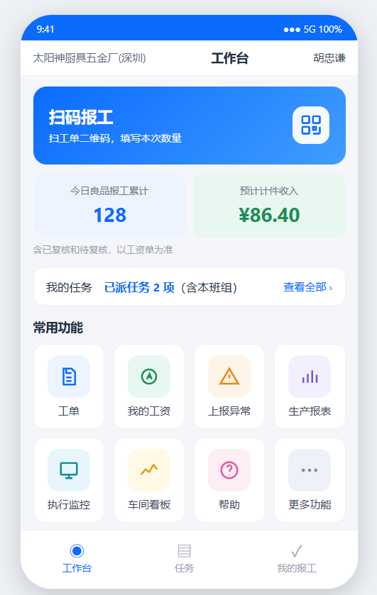

# 278-优化指令：手机工作台彩色八宫格与今日成果前置

> 状态：已实施；2026-10-23 构建、手册检查和隔离浏览器验证完成；真实登录/真机验收待完成，不部署。
> 依据：用户提供的豆包工作台参考图，以及本次讨论确认的彩色图标、两排四列、任务摘要与金额口径。
> 适用：手机/PDA H5 工作台。落地前核对现有代码并保留工作区其他改动。

## 一、目标与已定取舍

工作台打开后先看到扫码入口和今日成果，常用功能以彩色图标两排四列展示，兼顾信息密度与识别效率。

- 保留豆包参考图的蓝色扫码主卡、浅彩色统计卡和八宫格风格；不照搬首页任务详情、不新增“今日不良”统计。
- 本指令实施后，替代277中“常用功能两列、今日计件在常用功能后、管理操作在首页”的布局规定；277的任务摘要、权限、失败处理、底栏分工继续有效。
- 不改表、不改后端、不改接口契约、不增加授权档或自定义工作台配置。
- 最终视觉基准为用户最后提供的豆包精细版：紧凑顶栏、单行任务摘要、独立白色入口卡片、细边框与浅彩色图标底；参考图只用于视觉和排布，图中数量、金额、工单、任务状态不能作为业务依据或写死到代码。

参考图：

## 二、页面顺序与内容

### 1. 顶栏

保留厂名、工作台、当前登录人、退出。厂名和姓名较长时允许换行或省略，退出始终可点；不新增头像或个人中心，不让顶栏抢占大面积。

### 2. 扫码报工主卡

- 蓝色主卡，左侧大字【扫码报工】，副文案【扫工单二维码，填写本次数量】，右侧扫码图标。
- 整张卡片可点，继续进入 `/h5/scan`；不改为直接调用摄像头，不承诺“一键提交”。
- 沿用 `canScan` 授权判断：不可用时隐藏，不用空白卡占位。
- 参考高度96～112px，圆角14～16px；采用轻微蓝色渐变即可，无需动画。

### 3. 今日成果（从原页面底部移到扫码下方）

有原工资授权 `canWage` 时，显示并排两张卡：

| 卡片 | 数据与文字 | 配色 |
|---|---|---|
| 今日良品报工累计 | 现有 `todayGoodQty` | 淡蓝底、蓝色大数字 |
| 预计计件收入 | 现有 `todayWage`，沿用金额格式，人民币符号、两位小数 | 淡绿底、绿色大数字 |

- 两卡下面完整显示【含已复核和待复核，以工资单为准】，不缩成仅“以工资单为准”。
- 继续使用 `getTodayPieceSummary()`，不改变统计日期、待复核/已通过范围、计价及工资计算。
- 良品累计沿用原数量显示，不擅自给跨产品累计加“件”等统一单位。
- 无 `canWage` 时整块隐藏，也不调用该统计接口；不借本次改版扩大数量或金额的可见范围。
- 加载时显示加载提示，不先显示0；失败时用整块错误提示与【重试】替代数字，不把失败当0；成功且确为0时正常显示0和¥0.00。

### 4. 我的任务

- 保留一行可点击摘要：【已派任务 N 项（含本班组）】与【查看全部 ›】，点击进入 `/h5/tasks`。
- 首页不渲染具体工单、产品、进度条、剩余量、【去报工】卡片，不在首页重复任务列表。
- 继续按 `myTasks()` 返回的既有集合长度计数，不过滤历史、不改去重规则；禁止把它命名为“待报工”“待加工”“待办”。
- 加载、空集合、失败与重试沿用现有分支；加载/失败不显示伪造数量，失败时仍可【查看任务】进入任务页。

### 5. 常用功能：彩色八宫格

默认完整可见的顺序如下，从左到右、从上到下，每排4个：

| 顺序 | 入口 | 原目的地址 | 建议浅底色与图标 |
|---|---|---|---|
| 1 | 工单 | `/h5/orders` | 淡蓝，单据 |
| 2 | 我的工资 | `/h5/my-wage` | 淡绿，钱包/钱币 |
| 3 | 上报异常 | `/h5/abnormal` | 淡橙，警示 |
| 4 | 生产报表 | `/stat?from=h5` | 淡紫，柱状图 |
| 5 | 执行监控 | `/execution-monitor?from=h5` | 淡青，显示器 |
| 6 | 车间看板 | `/board?from=h5` | 淡黄，趋势/看板 |
| 7 | 帮助 | `/h5/help` | 淡粉，问号 |
| 8 | 更多功能 | `/h5/more` | 淡灰蓝，省略号 |

- 图标在上、文字在下，整格可点；使用统一风格的现有Vant图标或项目SVG，允许不同图标颜色和浅色底，不使用系统emoji或外链图片。
- 图标底块约48～56px，图标24～28px；标签13～14px，建议整格高度96～104px（包含白色卡片内边距、图标底块和文字），点击区域至少44×44px。
- 八宫格使用固定4列，如 `repeat(4, minmax(0, 1fr))`；标签可两行，不截成无法辨认的文字，不出现横向滚动。
- 不要求所有用户都有8项：按权限隐藏后，剩余入口按原顺序紧凑排列，仍为4列；不足两排正常减少，不补假入口、不显示锁定占位、不把剩余按钮拉成两列。
- 不额外新增首页第9项“管理操作”，不复制底栏“我的报工”“复核”。

## 三、视角与权限：显式条件

| 条件 | 首页行为 |
|---|---|
| 视角配置已成功加载，且非“仅看我的任务” | 可显示工单、生产报表、执行监控、车间看板 |
| “仅看我的任务” | 上述4个入口全部隐藏；保留按原授权可用的其他入口 |
| 视角加载中或加载失败 | 上述4个入口均不显示，防止先闪现再隐藏；失败显示带上下文的提示和重试，不展示假数据 |
| 有 `canWage` | 显示我的工资、今日成果 |
| 无 `canWage` | 隐藏我的工资与今日成果，不请求工资摘要 |
| 有/无扫码授权 | 按 `canScan` 显示/隐藏扫码主卡 |
| 管理员/班组长且有复核授权 | 继续由原底栏显示复核；不新增首页复核入口 |

生产报表、执行监控和车间看板从现有更多功能页提升到首页，必须复制该页的原视角约束，保留 `from=h5`，不新开浏览器标签、不改目标页面。

底层路由、接口和部门报工权限继续由现有逻辑校验；入口前移不构成新增业务授权。产品编号唯一、按部门报工、依赖倒序删除三条硬规则不受影响。

## 四、管理操作归入更多功能

- `/h5/more` 原报表、监控、看板、帮助入口保留，作为已有入口，不因首页前移而删掉；同时增加按角色显示的【管理操作】入口。
- 点【管理操作】继续打开原Vant操作菜单；只迁移入口与必要的菜单逻辑，不改补报表单和后台接口。
- 管理员：代报工、一键补报未完工序、补报开工记录、管理后台。
- 班组长：代报工、管理后台；不能看到或选择管理员专有的两种补报。
- 生产人员：不显示管理操作。管理菜单独立按角色判断，不因更多功能页的任务视角或报表配置失败而误删管理员已有管理能力。
- 选择菜单项时再次校验角色，取消不导航；复用 `reportManagement.js` 的目的路由/校验，管理后台仍进 `/order`。
- 删除首页原管理操作入口及仅供它使用的菜单状态、无用导入，避免出现两套重复入口或死代码。

## 五、视觉与手机适配

- 页面使用浅灰白底、白色分区、深色文字；蓝色突出主操作、绿色突出收入。彩色集中在图标和统计卡，不把所有区域都铺成浓色。
- 保留豆包的紧凑感，不复用上一张模拟图过高的扫码卡、超大标题或宽大两列功能按钮。
- 标准布局：紧凑顶栏 → 扫码主卡 → 两张成果卡及口径说明 → 任务摘要 → 两排四列常用功能 → 原底栏。
- 在375×812 CSS视口、正常字号、关闭PWA引导时，以主要内容尽量一屏可见为目标；不得为凑一屏把文字缩小或遮住底部入口。320px宽、较矮PDA、放大字号允许纵向滚动。
- 沿用页面底部安全区和底栏预留空间，最后一排可完整滚到可见位置，不被底栏遮挡。
- 不加参考图右下角的浮动向下箭头，不加轮播或装饰动画。
- 保留已完成的PWA图片和顶部固定的【以后不再自动弹出】【只关闭本次】按钮、永久关闭记忆逻辑，不因首页重排回退。

## 六、实施落点与文档同步（开工时执行）

1. `frontend/src/views/h5/home.vue`：主卡、成果位置、任务摘要、彩色八宫格、首页受限入口与加载/失败分支，移走管理菜单。
2. `frontend/src/views/h5/more.vue`：接入管理菜单与原角色/目的路由；保留原功能及视角限制。
3. `frontend/src/utils/reportManagement.js`：优先复用，不为布局改动改变原路由契约；确需共享时保持原调用兼容。
4. `docs/开发手册和方案/01-PRD需求规格说明书.md`：同步新版四列入口、成果前置、管理入口移到更多功能的约定，修正原工作台及一键补报入口描述。
5. `docs/开发手册和方案/31-使用手册-工人（手机端）.md` 及直接描述受影响入口的帮助资料：同步首页布局和【更多功能→管理操作】路径；自动生成资料通过 `manual:sync` 更新。
6. 实施结束将本指令及参考图一起移到 `docs/已做指令/`，保持相对图片引用有效，状态据实填写；未实测项不勾选。

只改相关源码与文档。不改PWA组件、不改扫码/任务/报表页面、不改底栏职责、不开发PC新功能、不发布部署；不覆盖工作区既有改动。

## 七、验收清单

- [ ] 首页顺序符合本指令，彩色八宫格完整视角下恰为两排四列；不同图标统一风格，无emoji。
- [ ] 任务只显示摘要，任务入口统一进入原任务页；数量未变成待办，加载/空/失败/重试均正确。
- [ ] 有授权时成果前置，数字来源及金额口径不变；无授权不显示且不请求摘要；成功0与失败清楚区分。
- [ ] 完整视角8个入口逐个能到达原目的页，3个PC查询页保留 `from=h5` 及返回体验。
- [ ] 仅任务视角隐藏工单及3个查询入口；视角加载/失败无受限入口闪现，重试后正确恢复。
- [ ] 管理员4项、班组长2项、工人无管理操作；入口位于更多功能；取消、角色检查、导航均正常，未授予额外补报权限。
- [ ] 普通角色3个底栏、满足原条件的管理角色4个底栏均正常；我的报工与复核不在首页重复。
- [ ] 320/375/430px宽及较矮视口无横向溢出，字号放大可读，末排不被底栏遮挡，长厂名与姓名不挤掉退出。
- [ ] PWA引导首次打开与关闭行为不回退，两个明确按钮保持顶部可见。
- [x] `npm run manual:sync`、`npm run manual:check`、`npm run build` 通过；差异检查只含本次相关改动。构建如遇系统Temp锁，沿用项目内临时目录方式。
- [x] 提供实际页面截图（至少375px完整视角、仅任务视角），注明验证账号角色/授权与未验证分支；模拟图不能充当运行截图。

## 八、交付边界

本轮已获自动实施授权：修正指令后实施页面、同步文档并按清单验证；未做真实登录/真机验收必须明示。Git备份遵守项目授权与规则，部署需另行安排。

## 执行记录

已按最后一张豆包精细版修正视觉基准；落实白色入口卡片、彩色图标、今日成果前置、任务摘要与管理菜单迁移。权限和统计口径保留，未改后端。

验证详情及实际组件截图见 [278验证记录](../测试方案/278-工作台验证/验证记录.md)。部分条目包含真机、业务导航和异常恢复等未验内容，保持未勾选；隔离验证通过不代表真实登录验收完成。
