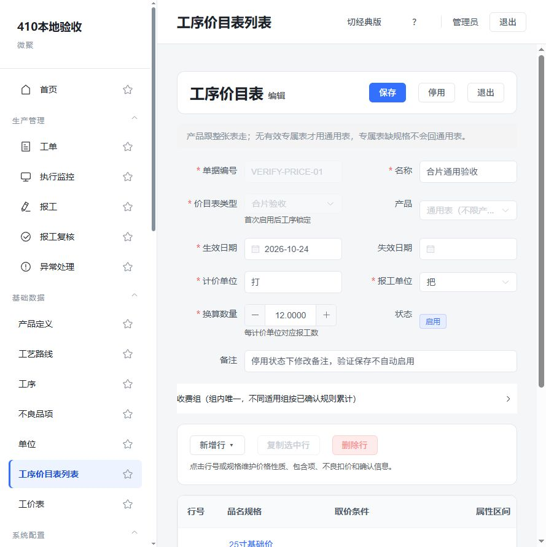

# 412-工序价目表410落地与本地验证记录

日期：2026-10-24。范围：410及404/405/409最小依赖，复核401历史兼容；不含服务器部署、客户资料清理、客户Excel导入或HY账套重建。

## 依次落地清单

- [x] S1 权威文档、表级DDL与API契约同步。
- [x] S2 工单工序字段归属、值校验、PC字段管理。
- [x] S3 表头产品绑定、专属/通用选择、状态/锁定/版本/删除保护、旧行级配置隔离及旧导入阻断。
- [x] S4 PC列表、单据头、七列主表、行详情及条件编辑器。
- [x] S5 工单工艺录入、建单/复制重新取价、锁价与历史兼容。
- [x] S6 最终构建、针对性测试及本地核心页面验收。

## 已实现的行为

产品绑定仅在表头；行保留旧ProductId只用于旧JSON读取、拒绝新版写入和转换清单展示，不用于新版匹配。先选择当前日期唯一有效专属表，无有效专属才选择通用表；专属缺规格明确缺价。不同产品专属表和通用表可以并存，同范围启用期不可重叠（首尾都包含）。

完整草稿保存即启用，不完整存草稿；停用表保存保持停用，重新启用重新校验。首次启用后工序在服务端永久锁定。所有写操作核对版本、厂及引用，SQL Server同厂事务锁与Serializable范围检查保护并发；字段定义写操作也共用该锁，避免首张表与删选项并发绕过保护。

工艺字段定义target=work_order_task且绑定本厂operationId，值绑定具体任务ID。仅合并产品属性和当前工序工艺值；禁止覆盖产品固有字段、跨工序、跨厂。建单与工艺值、服务端重算锁价同事务；复制带工艺重新取价，数量交期编辑保留原快照，已锁价工艺不能直接改。

新增独立增量迁移202610240002，与启动兼容共用幂等SQL，不改原迁移。旧schemaVersion=1资料保留原始绑定，不自动转为通用表，相关启用旧表阻断新单；允许停用旧表，人工核实后新建schemaVersion=2表。历史Processing/报工快照不改。旧价目表导入/template明确拒绝，普通产品导入保留。

## 验证方式及证据

- 本机SQL Server独立库：WorkshopMes_410_Test_随机编号，测试创建并自行清理；UI/API使用WorkshopMes_410_UI_Verification。没有连接或修改HY等客户账套。
- 后端相关测试含产品属性原子性、产品/路线/工单复制回滚、工资原值换算和280快照兼容、表级取价与工单工艺。标准dotnet test在本会话因测试宿主无权监视父进程而中止；使用独立进程直接执行同一批Fact/InlineData及原断言，不将宿主中止记成测试通过。
- 针对性回归实际45个非SQL专项用例通过；2个SQL专项在无SQL开关时不运行，另在MES_410_TEST_SQL=1下运行全部10个表级专项。两个集合有重叠，不当作55个独立场景。
- SQL专项验证：状态及锁定、专属/通用并存、专属缺规格不回通用、跨厂/跨工序字段拒绝、草稿删除及引用、旧导入拒绝、复制新价及旧快照、字段引用保护、并发启用仅一张成功、首尾日期重叠、旧表增量升级连续执行两次且行产品原值不变。
- 构建：前端生产构建通过，已有大包体提示保留；后端与测试项目构建通过。最终重跑结果见末节。
- 真实PC操作：登录本地独立账套；新增VERIFY-PRICE-01（通用表、合片、尺寸=25、5元/打、每打12把）；保存后列表启用，工序不可改；停用后修改备注并保存仍停用，再启用成功；试算显示命中来源和换算。
- 真实PC建单VERIFY-ORDER-01，数量120、丝印片数3；复制VERIFY-ORDER-02，工艺仍为3并重新预览保存。数据库及GET详情回查两单各自的任务工艺和5元/打锁价。
- 真实HTTP：无登录401、工人账号403、过期版本保存拒绝、过期预览拒绝、已锁价工艺修改拒绝。跨厂验证在服务端专项中执行。
- 同时修复现有operationPricing.js迁移状态函数引用未定义http的问题，改用该文件已有request。

## 保留未验证/后续范围

没有声称全仓测试全部通过；本轮只执行上述针对性用例。未逐一覆盖九张客户原表的所有价格、不确认原Excel歧义和收费叠加，不将固定模拟资料当真实报价。客户现场联调、部署、新格式Excel价目表导入、HY模拟数据清理/重导、完整计时工资专项以及大数据分页/多浏览器回归保持待做。410原细项验收中未逐一观察的分支不预勾。

404/405/409只完成410需要的开发依赖，不把其全部客户数据工作归档为已做。只归档410，关联待办继续保留。

## 最终复核

- [x] 后端最终构建及相关回归（独立断言执行器47通过，其中2项SQL专用在普通轮次跳过；实际45项回归）。
- [x] SQL Server最终专项（10通过、0失败，含上述2项SQL专用）。
- [x] 前端最终生产构建及字段组件语法复核。
- [x] 本地PC核心流程及真实HTTP权限/版本/锁价验证。
- [x] 410清单更新、指令归档至已做指令。
