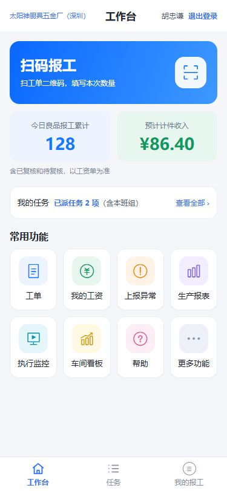
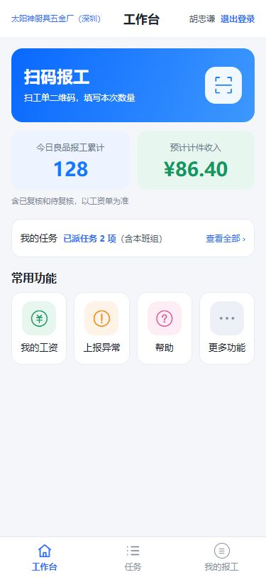
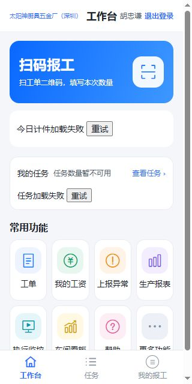
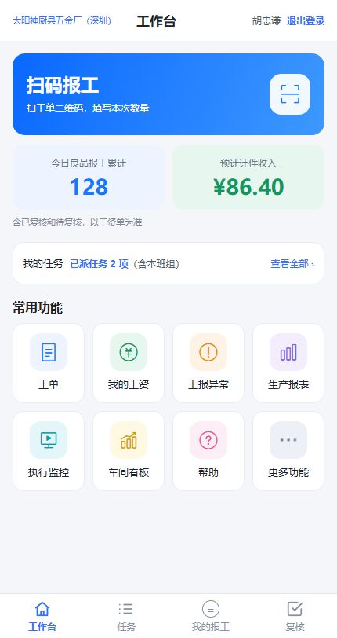

# 278 工作台验证记录（2026-10-23）

## 验证环境

实际 home.vue、more.vue 及原组件通过隔离Vite页面加载，接口使用模拟返回，角色/授权写入仅供验证的本机页面。不是生产登录、不是AI模拟图；图片数字为验证样例，不代表真实账套。临时验证服务未接生产数据。

## 已验证

- 前端生产构建通过；仅有既有大文件体积提示。
- manual:sync、manual:check通过，76个章节、16处图片和12篇同步资料一致。
- 375×812普通工人、enterprise、完整视角：8个功能、今日成果、任务摘要、3项底栏均可见。检查DOM中8个目的地址，三个查询地址保留from=h5。
- 375×812仅任务视角：工单、生产报表、执行监控、车间看板隐藏，保留工资/异常/帮助/更多功能。
- 视角加载失败且trial：四个查询入口隐藏，扫码/工资/今日成果隐藏；body记录的摘要调用次数为空，确认未请求摘要。
- 更多功能：admin + 视角失败仍可打开管理菜单，显示4项；班组长显示2项；工人不显示管理操作。
- 320×640任务/计件失败：显示失败与重试，不显示伪造0，保留查看任务；较矮视口需要纵向滚动。
- 430×812管理员、enterprise：8个功能、4项底栏；按截图核对无可见横向溢出。
- 本次未修改PWA组件、扫码/任务/报表页面、后端、接口与统计规则。

## 未验证

真实账号接口与完整业务导航、实际PDA/手机、放大字号及长姓名、加载瞬间和失败重试恢复、空任务与成功零金额、PWA真实打开与记忆流程未做运行验收。菜单取消的自动点击受隔离iframe/浏览器可见区域影响未完成，不标记通过；仍沿用Vant原取消行为。

## 截图

